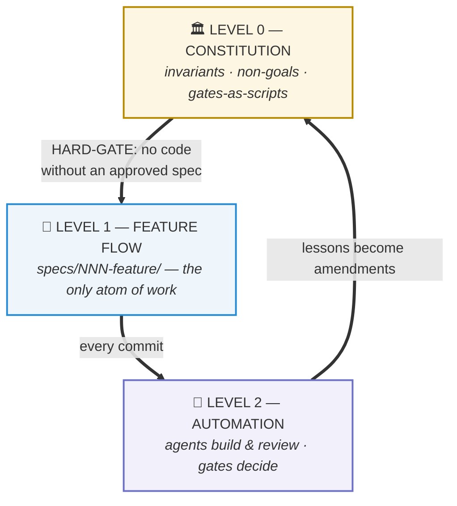
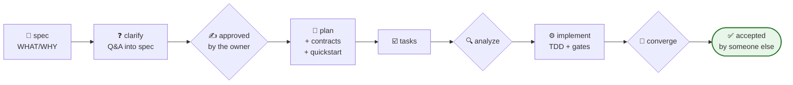

<!-- WHO READS ME: a human deciding whether to use this kit, and then installing it. An AI
     reads AI-ONBOARDING.md instead. I POINT TO: AI-ONBOARDING.md (the adoption procedure) ·
     model/PHASE-0.md (starting from an idea) · harness/HARNESS.md §7 (hosts and platforms) ·
     sync/DAILY-SYNC.md (staying current) · THIRD_PARTY_NOTICES.md (upstream credits).
     README.vi.md carries the same content in Vietnamese; change both together. -->

# 🏭 AI Factory Kit

**English** · [Tiếng Việt](README.vi.md)

**A spec-first operating kit for AI-driven software development, distilled from building Nexus.**
Spec-first · executable gates · adversarial verification · one atom of work.

> Like [GitHub Spec Kit](https://github.com/github/spec-kit) — but it doesn't stop at specs.
> This kit is the **whole factory**: the constitution above the specs, the agents beside them,
> the gates below them, and the daily discipline that keeps all of it honest. The core loop —
> constitution, spec-first flow, gates, third-person acceptance, the careful guard — was forged
> (and paid for) on a real production platform built ~100% by AI across 730+ commits. Newer
> guidance (the archetypes, the release lanes, the LLM/ML eval rules) has not been through a real
> adoption yet, and says so where it is doctrine rather than measurement.

**Supported.** Claude Code on Linux, macOS and WSL (project on the Linux filesystem).
Best-effort: native Windows, with Claude Code running hooks under Git Bash (without Git Bash
there is no guard). Other AI hosts
(Codex, Gemini CLI, Copilot, Cursor, …): the model, the specs, the Spec Kit flow and the gates
carry over; the harness (the `.claude/` layout, agents, rules) and the careful guard need
porting by hand. What differs per host and platform: [HARNESS §7](harness/HARNESS.md).
**What has actually run for 1.4.0:** every test suite in CI on Linux (bash 5.2) and on macOS
(the system bash 3.2 and BSD tools), as checked out and detached — the first macOS run failed
on a test fixture, fixed before release; headless Claude Code sessions on Linux, including the
careful guard's live probes. Nothing has run on WSL or on a Windows host.
Version 1.6.2 ([VERSION](VERSION)), tested with Spec Kit (specify-cli) 1.3.2.

## Why this exists

Most "AI coding setups" die from the same five diseases:

| Disease | What it looks like | The cure in this kit |
|---|---|---|
| **The joint nobody wired** | Backend correct + frontend correct + *nobody wrote the connection* — and every gate stays green because each gate checks only ONE end | [`gates/GATES.md`](gates/GATES.md) — ask *"who will CALL this?"* + orphan-endpoint gates |
| **Docs drift from code** | The spec says 13, the code has 14; the plan says done, the map says ⬜ | [`model/SPEC-FLOW.md`](model/SPEC-FLOW.md) `analyze`/`converge` + self-globbing plan-sync gate |
| **The agent grades its own homework** | "I tested it, it works" — with an admin account that bypasses every ACL | Third-person acceptance law — [`gates/GATES.md`](gates/GATES.md) §3 |
| **Six vocabularies for work** | Epics, milestones, slices, waves, tickets, backlog items — all half-alive | ONE atom: `specs/NNN-feature/` — [`model/LEVELS.md`](model/LEVELS.md) |
| **Memory that lies** | A memory file frozen in June while the code shipped through September | Constitution governance + retro-fit discipline — [`model/RETROFIT-PLAYBOOK.md`](model/RETROFIT-PLAYBOOK.md) |

## Proof

What was measured, on which inputs, and what still fails. Each number links to the file that
holds its method.

| What | Inputs | Number |
|---|---|---|
| Guard false positives, before the fix ([method](harness/skills/careful/SKILL.md#-the-third-lesson-measure-the-false-positives-or-the-guard-gets-switched-off)) | 6,638 real shell commands from 48 h of agent work, through the v1.2 guard | 800 asks (one in eight commands); 77 after three rules were narrowed |
| Guard false positives, real traffic | the 2,002 unique shell commands from the sessions that built and audited v1.4.0 | v1.3.2 interrupted 165 (8.2%), v1.4.0 interrupts 89 (4.4%), each by a designed rule |
| Guard false positives, constructed corpus ([`careful-corpus.txt`](harness/skills/careful/hooks/careful-corpus.txt)) | 395 ordinary commands across 14 stacks | 0 interrupted; the test fails if one ever is |
| The kit's own tests ([CI](.github/workflows/ci.yml)) | 9 `*.test.sh` suites, Linux and macOS `/bin/bash` 3.2, branch and detached `HEAD` | 1,492 checks, 0 failed on 2026-11-04 (macOS run; CI covers Linux, without the 2 that need `claude`); the guard table alone is 747 rows |
| A test that graded its environment, not the code ([DAILY-SYNC](sync/DAILY-SYNC.md)) | v1.3.2's guard test on a feature branch | failed 141 of 142 on every feature branch; the table is now hermetic and CI runs it on a detached `HEAD` |
| Defects a fresh-context verifier caught on a real codebase ([write-up](https://github.com/doxuta/nexus/blob/main/docs/writeup/turning-the-lights-back-on.md#4-lights-on)) | the first four feature PRs of a public codebase ([#15](https://github.com/doxuta/nexus/pull/15), [#16](https://github.com/doxuta/nexus/pull/16), [#20](https://github.com/doxuta/nexus/pull/20), [#21](https://github.com/doxuta/nexus/pull/21)), each refuted by a verifier with no edit tools, the pattern of [`tech-lead-review`](harness/agents/tech-lead-review.md) | 0 of 4 passed the first round; caught a privilege escalation through a draft/live name collision, a fix that lost grants on rollback, an agent endpoint mounted outside the middleware that read a stale model, a demo script that contradicted its own prompt while green in CI, and a recorded-response replay that crossed users |
| Spec Kit compatibility ([Verified](speckit/README.md#verified-on-2026-11-09-specify-cli-132)) | specify-cli 1.3.2 vs 1.2.5 in scratch repositories | every scripted check green; the overrides resolve byte-identical; 1.3.0 removed `/speckit-taskstoissues` from core (0 skills installed) |
| Plugin install ([test](bin/plugin.test.sh)) | `claude plugin marketplace add` + `install` from a clean `HOME` (Claude Code 2.1.312); a headless session with the plugin loaded, asked to force-push `main` in a scratch repo | 4 agents, 5 skills, 1 hook, ~1,040 tokens always-on (`claude plugin details`); the host refused the push and the remote's `main` did not move |
| Skills CLI install (`skills@1.7.6`) | `npx skills add doxuta/ai-factory-kit --list` from a clean `HOME`, then the four-skill command with `-a claude-code --copy` in a scratch repo, and again in a project set up with `adopt.py` | the CLI finds all 5 skills; the command writes 4 `SKILL.md` files and `skills-lock.json`, nothing else; with `careful` included it adds `.claude/skills/careful/hooks/` (5 files) and registers no hook; over an adopted project `adopt.py --check` goes from OK to 19 problems |
| Links | every relative link in the kit (`python3 bin/check-links.py .`) | 485 links, 0 dead |

**What still fails or is unmeasured.** The harness itself is unmeasured: no `claude plugin eval` run yet compares the same tasks with and without the kit's agents and skills ([method](gates/GATES.md#evals-are-gates-grade-the-grader-before-the-score)). The two live `claude -p` runs of the Spec Kit commands
were done once, on 1.0.12, and not repeated; a model can still drift from a template, which is
why the gates re-check on every commit. The guard's matcher is a string inspector: it asks or
denies on what a command says, not on what a script it runs will do. The guard's 7 s
self-timeout needs SIGALRM, which Windows Python lacks. The false-positive numbers come from one
maintainer's traffic; replay your own history for the number that is yours. On that codebase the verifier also needed extra rounds or missed: one PR took three rounds
(round 2's finding came from round 1's fix), three paths to a hidden table went to an issue
unfixed, and a known same-second edge failed CI twice before its root cause was fixed.

## The model at a glance

**Three levels.** The constitution rules everything; every feature is one directory; agents
verify but scripts decide.



**One feature, end to end** — the Level-1 loop ([full walkthrough](model/SPEC-FLOW.md)):



**Who does what** — the Level-2 roles ([definitions](harness/agents/)):

| 🕵️ [requirement-researcher](harness/agents/requirement-researcher.md) | 🎼 [task-orchestra](harness/agents/task-orchestra.md) | 🧪 [tester-e2e](harness/agents/tester-e2e.md) | 🧨 [tech-lead-review](harness/agents/tech-lead-review.md) |
|---|---|---|---|
| raw request → 80%-clean draft spec | file-disjoint dispatch, owns the merge | runs `quickstart.md` through the real entry point, never the builder — as a **non-privileged** account where there is one | adversarial multi-lens; findings fixed or refuted |

Three levels, one rule: **the spec directory `specs/NNN-<feature>/` is the only atom of work.**
Roadmaps are *views* over specs. Backlogs are *pointers* into specs. Nothing else holds content.

## Quickstart — for a human

You need git, python3 (3.8 or later), bash, [uv](https://docs.astral.sh/uv/) and Claude Code.
Spec Kit, which uv installs, needs Python 3.11 or later.

```bash
mkdir my-product && cd my-product && git init -b main     # or cd into your existing repository
git submodule add https://github.com/doxuta/ai-factory-kit factory
git -C factory checkout v1.6.2 && git add .gitmodules factory
python3 factory/bin/adopt.py --profile full               # or backend, frontend, cli, library, …
uv tool install specify-cli==1.3.2
specify init --here --force --non-interactive --integration claude
```

Then start Claude Code in the project and say: *"Read factory/AI-ONBOARDING.md and set this
project up."* It interviews you for the vision, proposes the kind of product (the archetype) and
two or three stacks, and drafts the constitution for **your** approval. It then fills
`.claude/CLAUDE.md`, registers the careful guard and proves it fires, and builds feature 001: a
walking skeleton that wires the gate chain, the pre-commit hook and CI. What only you decide is
listed in [PHASE-0 §8](model/PHASE-0.md). The exact order, with what each step leaves behind, is
[`AI-ONBOARDING.md`](AI-ONBOARDING.md) §2.

- **Starting from an idea**, with no code yet: [`model/PHASE-0.md`](model/PHASE-0.md).
- **An existing project**: `adopt.py` merges into an existing `.claude/` and never overwrites a
  file you wrote (the one thing it replaces is Spec Kit's unfilled constitution scaffold) —
  [AI-ONBOARDING §3](AI-ONBOARDING.md).
- **Not a submodule?** A plain copy of the kit in `factory/`, with no `.git` inside, also works.
  Not a plain `git clone` into `factory/`: git records it as an embedded repository, and every
  other clone of your project gets an empty `factory/` (`adopt.py` warns).
- **Teammates and CI** clone with `git clone --recurse-submodules`, or run
  `git submodule update --init` after cloning; an empty `factory/` leaves every link into it dead.
  Once feature 001 has installed the hook, every clone also runs
  `python3 factory/bin/adopt.py --install-git-hook` once: `core.hooksPath` is per clone, and a
  clone without it refuses no red commit (CI still does).
- **Staying current**: pin a tag, upgrade with `adopt.py --upgrade` —
  [`sync/DAILY-SYNC.md`](sync/DAILY-SYNC.md).

## Just the agents, skills and guard, as a plugin

```bash
claude plugin marketplace add doxuta/ai-factory-kit
claude plugin install ai-factory-kit@ai-factory-kit
```

In every project, from the next session: the [4 agents](harness/agents/) and
[5 skills](harness/skills/) under the `ai-factory-kit:` prefix, and the
[careful guard](harness/skills/careful/SKILL.md) on every shell command and file edit. Cost: about
1,040 tokens in every session, before anything is invoked (`claude plugin details ai-factory-kit`).

This is the harness without the factory. What only the full install above gives you:

- **The gates and the Spec Kit flow.** The agents and two skills name `gates/run-chain.sh`,
  `specs/` and `/speckit-*`; on a project that has none of them, those lines have nothing to run.
- **Your own guard rules.** The plugin's `careful.json` is the empty one and an update replaces
  it; `protected_branches` beyond `main` and `master`, `extra_deny` and the rest need
  `adopt.py --register-guard`, where the file is yours.
- **Links out of `harness/`.** 56 relative links in 14 files point at `gates/`, `model/` and the
  like, which an install does not copy. Read those on GitHub.

Both at once is fine: the guard runs twice and the stricter answer wins. The guard denies an
agent's `claude plugin disable`, `uninstall` or `marketplace remove` of this plugin, and an edit to
its copy, within the limits it states (a string inspector, not a sandbox); you do those in your own
terminal.

## Four of the skills, with `npx skills add`

```bash
npx skills add doxuta/ai-factory-kit --skill caveman ponytail spec-first plan-and-tdd -a claude-code
```

Copies those four `SKILL.md` files into `.claude/skills/` and writes a `skills-lock.json` beside
them ([skills CLI](https://github.com/vercel-labs/skills); without `-a` it installs into every
agent it detects). No agents, no hook, no gates.

- **Not `careful`, and not `--all`.** The guard is a hook; this CLI copies files and registers
  nothing. With `careful` it puts the matcher under `.claude/skills/careful/hooks/`, an
  unregistered copy that never runs (the trap behind
  [F10](harness/skills/careful/SKILL.md)), next to a skill that describes a guard that is not on.
  Get the guard from the plugin above or from `adopt.py --register-guard`.
- **Never in a project set up with `adopt.py`.** It overwrites the skill files `adopt.py`
  installed with the repository's raw copies, whose links point at `gates/`, `model/` and the
  like instead of `factory/`. Measured on 2026-11-10: `adopt.py --check` went from OK to 19
  problems (18 dead links and the second guard copy). Upgrade those projects with
  `adopt.py --upgrade`.
- **Links out of `harness/`** are dead in the copies, as with the plugin. Read those on GitHub.

## Quickstart — for an AI

You are an AI agent connected to a project that uses this kit. **Read
[`AI-ONBOARDING.md`](AI-ONBOARDING.md) first** — it is written for you, tells you the exact
reading order, the invariants you must never break, and how every file here links to the others.

## Using it day-to-day

The full command table (what each `/speckit-*` command writes, when to run it, which agent and
skill plug in where) lives in [`model/SPEC-FLOW.md`](model/SPEC-FLOW.md) — the kit's equivalent
of Spec Kit's command reference, extended with the roles and gates around each step. Work that
is not a feature — a bug, a hotfix, a refactor, a spike, a release — has its lane in
[`model/NON-FEATURE-WORK.md`](model/NON-FEATURE-WORK.md). "Done" is `./gates/run-chain.sh`
green. The kit ships the spec gates behind three of its slots (doc-sync, spec-approval,
spec-numbers) and a configurable reference for a fourth (orphan-endpoints); format, static,
test, build and acceptance are your stack's commands, and they stay red — "not wired" — until
feature 001 wires them ([GATES §1](gates/GATES.md)).

## What's inside

```
ai-factory-kit/
├── AI-ONBOARDING.md          ← an AI's entry point: read order + how to apply the kit
├── bin/                      ← adopt.py (install · merge · upgrade · audit) · link check · metrics
├── constitution/             ← Level 0: the constitution template (7 articles) + vision template
├── model/                    ← 3 levels · spec flow · Phase 0 · archetypes · lanes · retro-fit
├── harness/                  ← .claude/ skeleton: CLAUDE.md, rules, agents, skills, careful guard
├── gates/                    ← executable definition of done: chain runner + spec and sync gates
├── speckit/                  ← Spec Kit template overrides (spec, tasks), installed by adopt.py
├── sync/                     ← how this kit stays current, and how an adopter does
├── examples/todo-api/        ← worked example: multi-tenant web app, skeleton accepted + a feature mid-flight
├── examples/budget-cli/      ← worked example: single-user CLI, one feature accepted end to end
├── VERSION                   ← the kit release (1.4.0)
└── THIRD_PARTY_NOTICES.md    ← what was adapted from which MIT project, with their notices
```

Every doc under `constitution/`, `model/`, `harness/`, `gates/`, `speckit/`, `sync/` and
`examples/` opens with a header comment saying **who reads it and where it points** — right
after the YAML frontmatter in the files that must open with one (agents, rules, skills, specs,
the spec template) — the kit is a graph, not a pile. Broken cross-links are bugs: CI runs `python3 bin/check-links.py .` on every push.

## Lineage & license

Distilled from the Nexus platform factory (DOTB, 2026) — a metadata-driven multi-tenant engine
built spec-first by AI under human direction. Standing on:
[github/spec-kit](https://github.com/github/spec-kit) (MIT — the command flow, and the spec and
tasks templates adapted in [`speckit/overrides/`](speckit/overrides/)) ·
[obra/superpowers](https://github.com/obra/superpowers) (MIT — spec-first, plan-and-tdd) ·
[juliusbrussee/caveman](https://github.com/juliusbrussee/caveman) (MIT — its skill) ·
[DietrichGebert/ponytail](https://github.com/DietrichGebert/ponytail) (MIT) ·
[garrytan/gstack](https://github.com/garrytan/gstack) (MIT — the `careful` guard's matcher
logic and its two-tier design) · the [agentskills.io](https://agentskills.io) skill format.
Their copyright and permission notices, and exactly what came from each:
[THIRD_PARTY_NOTICES.md](THIRD_PARTY_NOTICES.md).

MIT — see [LICENSE](LICENSE). Kit updates flow in via the [daily-ship sync](sync/DAILY-SYNC.md);
see [CHANGELOG.md](CHANGELOG.md).
